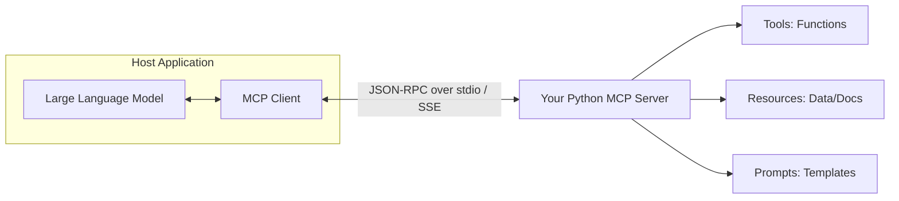

# The Comprehensive Python MCP Learning Guide

Welcome to building custom **Model Context Protocol (MCP)** servers in Python! This guide covers everything you need to know from first principles to production patterns.

---

## 1. What is the Model Context Protocol (MCP)?

The **Model Context Protocol** is an open standard introduced by Anthropic that standardizes how LLM applications (Claude Desktop, Cursor, Antigravity, custom agents) connect to external tools, databases, and contextual data.

### The Mental Model: USB-C for LLMs
Before MCP, every developer wrote bespoke tool-calling integrations for each LLM provider.
With MCP, you write your server **once**, and any MCP-compliant client can instantly discover and use your tools, read your data, and invoke your prompts.



---

## 2. The Three Core Primitives

| Primitive | Purpose | Analogy | Example in this Repo |
| :--- | :--- | :--- | :--- |
| **Tools** | Executable actions that LLMs call to do work or query data | Functions / APIs | `calculate`, `echo_message` in `src/custom_mcp_server/tools/` |
| **Resources** | Read-only context and data attached to URI schemes | File systems / Web pages | `memo://quickstart`, `memo://notes/{title}` in `src/custom_mcp_server/resources/` |
| **Prompts** | Pre-written reusable prompts with parameterized arguments | Slash commands / macros | `code_review`, `explain_concept` in `src/custom_mcp_server/prompts/` |

---

## 3. High-Level API: FastMCP & MCPServer

Python's official SDK provides a decorator-based interface inspired by FastAPI.

### SDK v1 vs SDK v2 Note:
- In SDK **v1**, this was named `FastMCP` (`from mcp.server.fastmcp import FastMCP`).
- In SDK **v2**, this was renamed to `MCPServer` (`from mcp.server.mcpserver import MCPServer`).
- This repository includes `custom_mcp_server.compat` which provides seamless compatibility regardless of which version is installed!

### How Tools Work: Type Hints & Docstrings
When you decorate a Python function with `@mcp.tool()`, MCP automatically:
1. Inspects your **docstring** to populate the tool's description.
2. Inspects your **type annotations** (e.g., `a: float`, `limit: int = 5`) to generate the JSON Schema.
3. Validates incoming arguments against your types and Pydantic models.

```python
from custom_mcp_server.compat import FastMCP

mcp = FastMCP("MyServer")

@mcp.tool()
def multiply(a: float, b: float) -> float:
    """Multiply two numbers.

    Args:
        a: First operand
        b: Second operand
    """
    return a * b
```

---

## 4. The Golden Rule of stdio Transport

When your MCP server runs via `stdio` (standard input/output):
> [!CAUTION]
> **NEVER use `print()` or write to `sys.stdout` in a stdio server.**
>
> In stdio mode, `stdout` is exclusively reserved for the JSON-RPC wire protocol. If you call `print("debugging...")`, that raw string is sent to the client, causing JSON parse errors and crashing the session.

### What to do instead:
Always use standard Python `logging` configured to `sys.stderr`:
```python
import sys
import logging

logging.basicConfig(stream=sys.stderr, level=logging.INFO)
logger = logging.getLogger(__name__)

logger.info("This is safe to log! It goes to stderr and won't break the client.")
```

---

## 5. How to Test Your MCP Server

You have three options for testing:

### Option A: In-Python Test Harness (Easiest)
Run the included client test script:
```powershell
python scripts/test_client.py
# Or with uv:
uv run python scripts/test_client.py
```
This spawns your server as a subprocess, runs a real stdio JSON-RPC handshake, discovers tools, calls `calculate`, and reads `memo://quickstart`.

### Option B: Pytest Unit Tests
Run the automated test suite:
```powershell
uv run pytest
```

### Option C: The Official MCP Inspector UI
Anthropic provides an interactive web UI called the **MCP Inspector**:
```powershell
npx @modelcontextprotocol/inspector uv run cus-mcp
```
This opens a browser tab where you can inspect tool schemas, test calls with form inputs, and view raw JSON-RPC traffic.

---

## 6. How to Build Your Own New Tool (Tutorial)

Adding a new tool takes 3 steps:

1. Open `src/custom_mcp_server/tools/` or create a new python file.
2. Define your function with clear docstrings and type hints:
   ```python
   def convert_currency(amount: float, from_curr: str, to_curr: str) -> dict:
       """Convert monetary amounts between currencies."""
       rates = {"USD": 1.0, "EUR": 0.92, "GBP": 0.79}
       converted = amount * (rates[to_curr] / rates[from_curr])
       return {"amount": amount, "from": from_curr, "to": to_curr, "result": round(converted, 2)}
   ```
3. Register it with `mcp.tool()(convert_currency)` in `src/custom_mcp_server/server.py`.
4. Run `python scripts/test_client.py` to see your new tool in action!

---

## 7. Connecting to Clients

### Claude Desktop
Add the following to `%APPDATA%\Claude\claude_desktop_config.json`:
```json
{
  "mcpServers": {
    "my-custom-mcp": {
      "command": "uv",
      "args": ["--directory", "D:\\cus_mcp", "run", "cus-mcp"]
    }
  }
}
```

### Cursor
Add to your Cursor MCP settings (`.cursor/mcp.json` or Global Settings):
```json
{
  "mcpServers": {
    "my-custom-mcp": {
      "command": "uv",
      "args": ["--directory", "D:\\cus_mcp", "run", "cus-mcp"]
    }
  }
}
```
